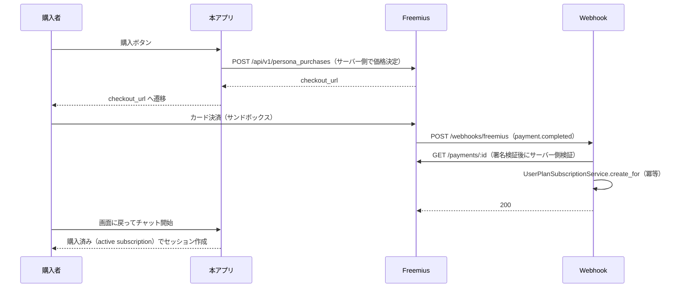

# 購入→チャット利用の再現手順（開発環境）

> **目的**: AI ペルソナの「購入 → チャット利用」を、実課金なしで開発環境で再現する
> **対象**: routeflags/agent-bank（Issue #18）
> **作成日**: 2026-10-23
> **関連 Issue**: #18「[致命的] 購入フローが動作せず、ペルソナを利用できない」

---

## 1. 前提となる仕組み

| 項目 | 内容 |
|------|------|
| チャット開始条件 | `UserPlanSubscription`（`status: active`）または無料ペルソナ（`Listing#free_to_use?`） |
| 購入権利の付与（本番・Freemius） | `payment.completed` Webhook（persona_purchase）→ サーバー側検証 → `UserPlanSubscriptionService.create_for`（[Issue #23](https://github.com/routeflags/agent-bank/issues/23)。**キー投入は未実施**。詳細は §11） |
| 購入権利の付与（本番・取引） | 取引ステートマシンの `confirmed` 遷移（実決済の完了） |
| 購入権利の付与（管理者） | 手動付与 Rake（`lamprey:purchases:grant`。**production でも可**。運用手順は [manual_purchase_grant.md](./manual_purchase_grant.md)） |
| 購入権利の付与（開発/テスト） | `DevPersonaPurchase`（API / Rake。**production では常に無効**） |
| 決済プロバイダ | Freemius（Merchant of Record）。開発環境ではキー未設定のため実決済不可 |

> `free` 遷移（コンタクト等、決済なしで成立した取引）では購入権利を付与しない。
> 付与すると「コンタクトだけで購入権利＋初回トークンが得られる」購入偽装になるため。

---

## 2. 必要な環境

| ツール | バージョン | 備考 |
|--------|-----------|------|
| Ruby | 3.4.10 | `rbenv` 等 |
| MySQL | 8.x | `sharetribe_development` / `sharetribe_test` |
| Node.js | 18.16 | アセットビルド時のみ |

リポジトリのセットアップ（[local_development_setup.md](./local_development_setup.md) 参照）に加えて:

- `config/database.yml`（git 管理外）
- `.env`（git 管理外。§5 参照）

---

## 3. 手順 A: ブラウザ UI で通す（推奨）

### 3.1 開発購入を有効化する

開発購入は **二重ガード** で保護されている。両方を満たすときだけ有効になる。

1. `Rails.env` が `development` または `test`（`production` はフラグ値によらず無効）
2. 環境変数 `LAMPREY_ENABLE_DEV_PURCHASE` が truthy（既定は無効）

```bash
# .env（git 管理外）に追記
echo 'LAMPREY_ENABLE_DEV_PURCHASE=true' >> .env

# 起動中の場合は再起動して環境変数を読み込み直す
bin/rails server -b 0.0.0.0 -p 3000
```

> 既存プロセスを止めたくない場合は、プロセス限定で渡してもよい:
> `LAMPREY_ENABLE_DEV_PURCHASE=true bin/rails server -p 3001`

### 3.2 購入 → チャット

1. `http://localhost:3000/login` でログイン（開発用の購入者アカウント）
2. 有料の `run_online` ペルソナの詳細ページ（`/ja/listings/:id`）を開く
3. 「このスキルを利用する」を押す → チャットパネルが開く
4. 未購入のため「このペルソナを利用するには購入が必要です。」と「購入する」ボタンが表示される
5. 「購入する」を押す
   - 開発購入が有効: 購入権利（`UserPlanSubscription`）と初回トークンが付与され、続けてチャットセッションが作成される
   - 開発購入が無効: 本番購入 API（`POST /api/v1/persona_purchases`）を呼ぶ
     - Freemius 未設定（現在の開発環境）: 「購入機能は現在準備中です（決済が未設定）。」（503 由来）
     - Freemius 設定済み: Freemius Checkout の `checkout_url` へ遷移（§11）
6. 「購入が完了しました。チャットを開始できます。」が出たあと、メッセージを送信してストリーミング応答を確認

> 実 AI 応答まで確認するには AI プロバイダの API キー（例: `OPENAI_API_KEY`）と
> ウォレット残高（最低 10 cents）が必要。購入直後は初回トークンで残高が付与される。

---

## 4. 手順 B: Rake タスクで付与する（サーバー不要）

サーバーを起動せず、コマンドだけで購入状態を作れる。環境フラグは不要（オペレーターの明示操作とみなす）
が、`production` では実行できない。

```bash
# 引数: [listing_id, person]
# person は Person ID / username / メールアドレスのいずれか
bin/rails 'lamprey:dev:grant_persona[123,buyer@example.com]'
```

実行例:

```text
[lamprey:dev:grant_persona] 購入権利を付与しました: subscription_id=123
  person=devbuyer (xxxxxxxxxxxxxxxxxxxxxx)
  listing=123 サンプルペルソナ
  wallet_balance_cents=200000
```

2 回目以降は `既に購入済みです: subscription_id=...` と表示され、二重付与されない。

---

## 5. 手順 C: API を直接叩く（検証・自動化用）

```http
POST /api/v1/dev/persona_purchases
Content-Type: application/json

{ "listing_id": 123 }
```

| 状況 | ステータス | ボディ |
|------|-----------|--------|
| 開発購入が有効・未購入 | 201 | `{ "persona_purchase": { "subscription_id": 1, "status": "active", "billing_model": "token_based", "duplicate": false } }` |
| 既に購入済み | 200 | 同上（`"duplicate": true`） |
| 開発購入が無効（本番含む） | 404 | `{ "error": "見つかりません" }`（存在を隠す） |
| ペルソナが存在しない | 404 | `{ "error": "ペルソナが見つかりません" }` |
| 未ログイン | 401 | `{ "error": "ログインが必要です" }` |

その後、チャットセッションを作成できる:

```http
POST /api/v1/chat_sessions
Content-Type: application/json

{ "listing_id": 123 }
```

---

## 6. Freemius 未設定時の振る舞い（本番）

| 項目 | 未設定時の挙動 |
|------|----------------|
| `FreemiusClient.configured?` | `FREEMIUS_API_KEY` が無いため `false` |
| ウォレットチャージ | Stripe 直接連携にフォールバック（Stripe も未設定ならエラー、開発は擬似決済） |
| ペルソナ購入 | 本番購入 API は実装済み。未設定時は **503 + `error_type: purchase_not_configured`**（§11）。開発購入 API は 404（本番では無効） |

### 投入が必要な環境変数（値は書かない）

| 変数名 | 用途 | 必須 |
|--------|------|:----:|
| `FREEMIUS_API_KEY` | Freemius REST API の Bearer トークン | 必須 |
| `FREEMIUS_WEBHOOK_SECRET` | Webhook 署名検証（`x-signature`） | 必須 |
| `FREEMIUS_API_BASE_URL` | API のベース URL。既定は `https://api.freemius.com/v1` | 任意 |
| `LAMPREY_ENABLE_DEV_PURCHASE` | 開発購入の有効化。**production では効果なし** | 開発のみ |

投入手順（⚠️ 値はチャット・ログ・コミットに出さない）:

1. Freemius の Developer Dashboard で API トークンと Webhook シークレットを発行
2. 開発環境: `.env`（git 管理外）に追記する
3. 本番環境: デプロイ先のシークレット管理（環境変数）に登録する。ファイルに直書きしない
4. Webhook URL（`/webhooks/freemius`）を Freemius 側に登録する

> キー投入と実課金の実行は**オーナー承認が必要**。

---

## 7. 無料ペルソナ（価格 0 / 無料実行モード）の扱い

- 価格が未設定または 0、あるいは `default_run_mode == 'free'` のペルソナは **購入不要**（`Listing#free_to_use?`）。
  403 `purchase_required` を返さず、`UserPlanSubscription` が無くてもチャットセッションを作成できる。
- 購入権利が無い場合の `billing_model` は `token_based`（従量課金）。
- ⚠️ 既知の制約: 無料ペルソナでもトークン原価はウォレットから従量課金される（完全無料化は課金設計の変更であり別 Issue）。
- `run_online` 以外（`download` / `free`）のペルソナはチャットパネルがマウントされず、通常の注文フローになる。

---

## 8. 動作確認済みの検証（実測）

```bash
# 購入 → チャットの通しシナリオを含む
bundle exec rspec spec/requests/api/v1/dev_persona_purchases_spec.rb
bundle exec rspec spec/requests/api/v1/chat_sessions_spec.rb
bundle exec rspec spec/services/dev_persona_purchase_spec.rb
bundle exec rspec spec/services/persona_purchase_entitlement_spec.rb
bundle exec rspec spec/tasks/lamprey_dev_spec.rb

# 既存テスト（全体）
bundle exec rspec
```

上記は 2026-10-23 時点で全件成功（1409 examples, 0 failures）。ただし次に注意:

- 検証には **ビルド済みアセットが必要**（`app/assets/webpack/*`, `app/assets/javascripts/i18n/*.js`,
  `client/app/i18n/all.js`）。未ビルドのコピーではビューを描画する一部スペックが 500 になる。

```bash
# 初回のみ（Docker 環境で作業している場合は不要）
bundle install
bundle exec rake i18n:js:export        # app/assets/javascripts/i18n/*.js と client/app/i18n/all.js
cd client && npm install && npm run build:client && cd ..
```

> `bundle exec rake assets:precompile` を使うと、上記（`js:routes` / `i18n:js:export` / webpack）を
> 一括で実行できる。

---

## 9. トラブルシューティング

| 症状 | 原因と対処 |
|------|------------|
| 購入ボタンを押しても「準備中」と出る | `LAMPREY_ENABLE_DEV_PURCHASE` が未設定。`.env` に追記してサーバーを再起動 |
| API が 404 を返す | 開発購入が無効（`Rails.env` が development/test でない、またはフラグ未設定） |
| 購入後も 403 `purchase_required` | ペルソナが有料で、購入が別ユーザー/別 listing に付いている。`bin/rails runner` で `UserPlanSubscription.count` を確認 |
| 購入後に「残高が不足しています」 | ウォレット残高が 10 cents 未満。クレジットを追加するか再購入 |
| チャット応答が来ない | AI プロバイダの API キー未設定、または Delayed::Job ワーカー未起動（Docker で起動） |

---

## 10. セキュリティ留意事項

- 開発購入は `Rails.env.production?` で**常に**無効。`development` / `test` でも環境フラグが真のときのみ有効。
- `spec/[REDACTED]/dev_persona_purchase_spec.rb` / `spec/requests/api/v1/dev_persona_purchases_spec.rb` で
  「production では無効」「フラグ無効時は 404 で DB 不変」を固定している。
- 本番の購入導線（Freemius Checkout → 購入権利作成）は Issue #23 で実装済み（§11）。
  ただし **`FREEMIUS_API_KEY` / `FREEMIUS_WEBHOOK_SECRET` のキー投入は未実施**のため、
  現時点の全環境で 503（`purchase_not_configured`）になる。実 E2E（実決済を含む）も未実測。
- 購入 API は価格・通貨・購入者をサーバー側で決定する（クライアントは `listing_id` のみ指定可）。価格の
  改ざんや他人へのなりすまし購入は不可能。Webhook は署名検証 + Freemius へのサーバー側問い合わせ
  （`verify_payment_completed`）を通過しないと購入権利を作成しない。

---

## 11. 本番購入導線（Freemius Checkout → 購入権利作成。Issue #23）

> **⚠️ 現状: キー投入は未実施。** `FREEMIUS_API_KEY` / `FREEMIUS_WEBHOOK_SECRET` は
> どの環境にも設定されていないため、本番導線は 503（`purchase_not_configured`）で停止する。
> 実課金を伴うサンドボックス E2E も**未実測**（検証はすべてスタブで実施。§11.5 参照）。

### 11.1 フロー全体



### 11.2 API: `POST /api/v1/persona_purchases`（認証必須）

| 項目 | 内容 |
|------|------|
| 受け付ける body | `listing_id` のみ。価格・通貨・購入者はサーバー側で決定（クライアント値は信用しない） |
| 200 | `{ "checkout_url": ..., "payment_id": ..., "listing_id": ..., "amount_cents": ..., "provider": "freemius" }` |
| 200 | `{ "status": "already_purchased" }`（active な購入権利があれば Checkout は作らない） |
| 401 | 未ログイン |
| 404 | `error_type: "listing_not_found"`（ペルソナ不在） |
| 422 | `error_type: "free_listing"`（無料ペルソナは購入不要） |
| 503 | `error_type: "purchase_not_configured"`（`FREEMIUS_API_KEY` 未設定） |
| 502 | `error_type: "checkout_failed"`（Freemius API 側の障害・応答不正） |

Checkout 作成は `FreemiusClient.create_persona_purchase_checkout`（ウォレット用の
`create_checkout` とは別メソッド）。metadata は
`type: "persona_purchase"` / `user_id` / `listing_id`。

### 11.3 Webhook からの購入権利作成と冪等性

- 署名検証（`x-signature` = `FREEMIUS_WEBHOOK_SECRET` による HMAC-SHA256（raw body））に合格したあと、
  `payment.completed` は metadata の `type` で分岐する:
  - `type: "persona_purchase"` → **購入権利作成経路**（下記）
  - それ以外（`wallet_topup` / type なしの旧 Checkout）→ 従来どおりウォレットチャージ（既存挙動を維持）
- persona_purchase 経路: Freemius に `GET /payments/:id` で問い合わせ `completed` を確認
  （`verify_payment_completed`）→ `UserPlanSubscriptionService.create_for(
  person:, listing:, payment_reference: "freemius:<payment_id>")`
- 冪等: 同一 `payment_id` の再送でも ①`create_for` が同一 person+listing の active 購入権利を検出したら
  duplicate として返す（二重付与なし） ②`Wallet#topup!` が `payment_reference` の厳密一致で初期トークン
  の二重チャージ自体を防止
- listing / person が見つからない場合は警告ログを出してスキップ（500 にしない）
- Webhook URL: `POST /webhooks/freemius`（`config/routes.rb`）

### 11.4 キー投入とサンドボックス検証手順（投入後に実施する作業）

必要な環境変数は §6 の表を参照（値は書かない。チャット・ログ・コミットに出さない）。

1. Freemius の Developer Dashboard（サンドボックスモード）で API トークンと Webhook シークレットを発行
2. 検証環境の `.env`（git 管理外）またはデプロイ先のシークレット管理に `FREEMIUS_API_KEY` /
   `FREEMIUS_WEBHOOK_SECRET` を設定。本番の常時露出サーバーでは Webhook 署名が必須
   （未設定なら受信時に 401 で全拒否）
3. Freemius 側に Webhook URL `https://<ホスト>/webhooks/freemius` を登録し、`payment.completed` イベントを
   有効化
4. 有料ペルソナの詳細ページで「購入する」→ Freemius Checkout へ遷移する（503 が出ていないことを確認）
5. サンドボックスのテストカードで決済を完了
6. Webhook 受信ログ（`[FreemiusWebhook] Granted persona purchase: ...`）と `UserPlanSubscription` の
   作成、初期トークン付与、その後チャットセッションが作成できることを確認
7. 同一イベントを再送（Freemius の再送機能、または同一 payload を再 POST）し、購入権利・トークンが
   二重付与されないことを確認
8. 既存回帰: ウォレットチャージ Webhook（type なし / `wallet_topup`）が従来どおりチャージされることを確認

検証コマンド（キー不要・スタブのみ。本リポジトリで実行済み）:

```bash
bundle exec rspec spec/requests/api/v1/persona_purchases_spec.rb \
  spec/requests/freemius_webhooks_spec.rb spec/services/freemius_client_spec.rb
```

### 11.5 実行できなかった検証（キー投入後に残る作業）

| 検証 | 未実施の理由 | 投入後の対応 |
|------|-------------|-------------|
| Freemius サンドボックスでの実決済 E2E（受け入れ条件1） | `FREEMIUS_API_KEY` 未投入 + 実課金・外部送信の禁止 | §11.4 の手順を実行し、実測ログを Issue #23 に記録 |
| Webhook の実配信・実署名での受信 | `FREEMIUS_WEBHOOK_SECRET` 未投入 | §11.4 3〜7 を実施 |
| Checkout リダイレクト後の success/cancel 遷移先 | Checkout 作成時に `success_url` / `cancel_url` を渡していない（メソッドは対応済み・呼び出し側が未設定） | 遷移先を設計して API 呼び出しに追加（別課題） |
| `payment.refunded` での購入権利解除 | Issue #23 の候補4 として未決定。現状 refund はウォレットの反転のみ | 返金時の方針を決めて別 Issue で実装 |
