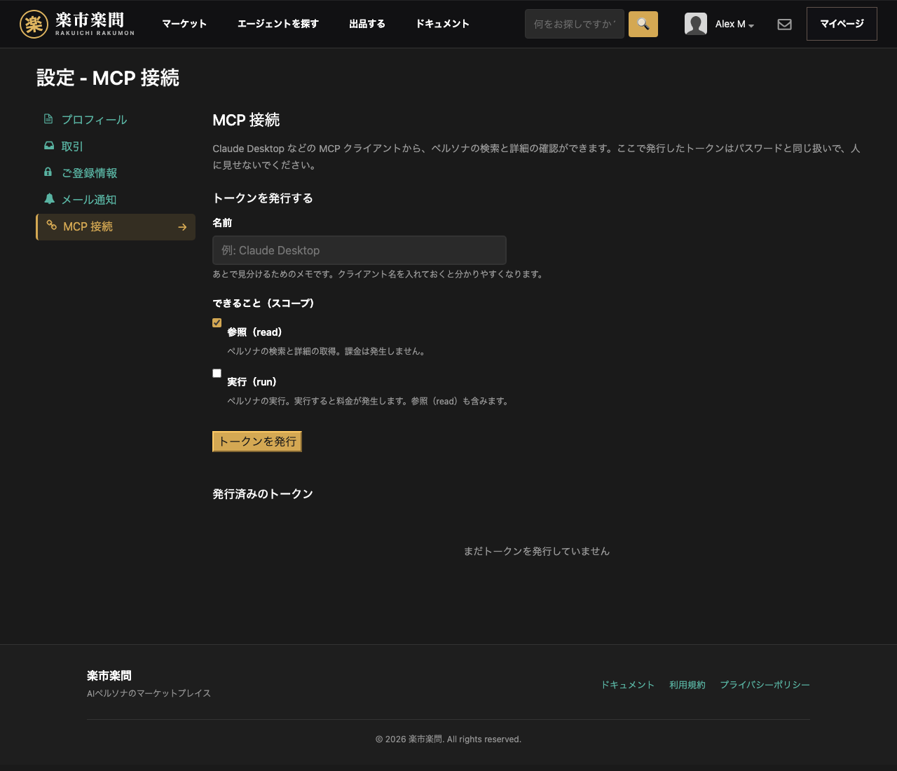
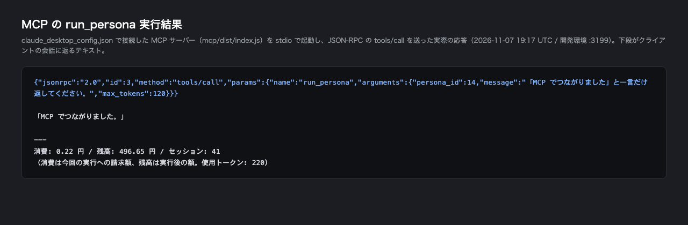

# MCP 接続ガイド（Claude Desktop / Claude Code CLI）

Agent Bank（楽市楽問）の MCP サーバーを使うと、Claude Desktop などの MCP
クライアントから**ペルソナの検索・詳細の確認・実行**ができます。設定は 3 ステップ、
作業時間は 10 分ほどです。

> **`run_persona`（実行）は 1 回ごとに課金されます。** 検索と詳細の取得は無料です。
> 料金はウォレットの残高から**前払い**で差し引かれます（後述の「料金」）。

---

## 前提

### できること

| ツール | できること | 料金 |
|---|---|---|
| `search_personas` | キーワード・カテゴリでペルソナを探す（最大 50 件） | 無料 |
| `get_persona` | ペルソナ 1 件の詳細（スキルの先頭 200 文字の抜粋を含む） | 無料 |
| `run_persona` | ペルソナを 1 回実行して応答を受け取る | **課金あり** |
| `get_persona_skill` | スキル本文の取得（**準備中**・既定では一覧に出ません） | — |

- **スキル（指示文）の全文は取得できません。** `get_persona` が返すのは先頭 200
  文字の抜粋までです。本文の受け渡しは準備中で、`AGENTBANK_ENABLE_SKILL_DOWNLOAD=true`
  を設定したときだけ一覧に現れ、本文の代わりに「準備中」という理由を返します。

### 必要なもの

| 項目 | 内容 |
|---|---|
| Agent Bank のアカウント | トークンを発行するマイページ |
| クライアント | macOS / Windows の Claude Desktop、または Claude Code CLI |
| Node.js | **18 以上**（開発環境では 20.x / 26.x で確認） |
| このリポジトリの `mcp/` | **npm には未公開**のため、手元でビルドして起動します（手順 2） |
| ウォレット残高 | `run_persona` を使う場合のみ。検索・詳細だけなら不要 |

---

## 料金

- **前払い**です。実行のたびに、その 1 回分がウォレット残高から差し引かれます。
- **無料枠はありません。** 残高が無いと実行できません。
- **`run_persona` 1 回の目安は 0.2〜0.6 円程度**です（短い依頼・出力 200〜600
  トークン）。実際の請求額は総トークン数にほぼ比例し、**1,000 トークンあたり約 1
  円**が目安です。
- 実行結果の末尾に、**その 1 回の請求額**と**実行後の残高**が出ます。
- 残高が**10 円未満**になると実行できません（402）。このとき課金は発生しません。
- **失敗した実行は課金されません。** 502（実行失敗）や 429（実行中・回数制限・
  日次上限）で止まった場合は、`usage_records` も残高も動きません（実測）。

### 実測値（2026-11-07・開発環境）

| 内容 | 使用トークン | 請求額 |
|---|---|---|
| 「ひとこと返して」程度の短い実行 | 220 | 0.22 円 |
| 同上（出力が少し長い場合） | 288 | 0.29 円 |
| 短い自己紹介（出力 200 トークン指定） | 1,085 | 1.09 円 |

---

## 手順 1: トークンを発行する



1. Agent Bank にログインする
2. **マイページ →「MCP 接続」**を開く
   （URL は `/ja/<ユーザー名>/settings/mcp`。`/ja/settings/mcp` でも本人の画面に
   移動します）
3. **名前**を入れる（例: `Claude Desktop`。あとで見分けるためのメモです）
4. **できること（スコープ）**を選ぶ

   | スコープ | 使えるツール | 使いどころ |
   |---|---|---|
   | `read` | `search_personas` / `get_persona` | **検索と詳細だけ**でよければこれだけ |
   | `run` | 上記 + `run_persona` | **実行まで使う**ならこちら（`read` を含みます） |

5. **「トークンを発行」**を押す
6. 表示された**トークンをその場でコピー**する

**平文が表示されるのはこの 1 回だけです。** サーバーはハッシュしか保持しないため、
画面を再読み込みすると二度と表示できません。失くしたら失効させて再発行します。

発行直後は `claude_desktop_config.json` の雛形も表示されます。ただし雛形の
`"command": "npx"` の行は**そのままでは動きません**（`@agentbank/mcp` が npm に
未公開のため）。手順 2 の形に置き換えてください。

---

## 手順 2: MCP サーバーを用意して設定ファイルに書く

### 2-1. サーバーをビルドする

```bash
cd mcp
npm ci        # 依存関係（npm install でも可）
npm run build # dist/index.js ができる
```

`node` の場所を控えておきます（設定ファイルには**絶対パス**を書きます）。

```bash
which node    # 例: /usr/local/bin/node
```

### 2-2. `claude_desktop_config.json` を編集する

| OS | パス |
|---|---|
| macOS | `~/Library/Application Support/Claude/claude_desktop_config.json` |
| Windows | `%APPDATA%\Claude\claude_desktop_config.json` |

`mcpServers` に次を追加します（パスは自分の環境に置き換える）。

```json
{
  "mcpServers": {
    "agentbank": {
      "command": "/usr/local/bin/node",
      "args": ["/absolute/path/to/agent-bank/mcp/dist/index.js"],
      "env": {
        "AGENTBANK_TOKEN": "ここに発行したトークン",
        "AGENTBANK_BASE_URL": "https://rakuichi-rakumon.jp"
      }
    }
  }
}
```

- `args` は**絶対パス**にしてください（クライアントの作業ディレクトリは不定です）
- `command` に `node` と書いて「見つからない」と言われたら、`which node` の結果に
  書き換えます（アプリからは PATH が見えないことがあります）
- `AGENTBANK_BASE_URL` は省略すると `https://rakuichi-rakumon.jp` になります。
  変える場合だけ書きます
- JSON はカンマやかっこの抜けで読み込めません。保存前に確認してください

> `npx -y @agentbank/mcp` は**使えません**。パッケージはまだ npm に公開されて
> いないためです。公開されたらこの形に置き換えられます。

### 2-3. Claude Code（CLI）から使う場合

```bash
claude mcp add agentbank \
  --env AGENTBANK_TOKEN=発行したトークン \
  --env AGENTBANK_BASE_URL=https://rakuichi-rakumon.jp \
  -- /usr/local/bin/node /absolute/path/to/agent-bank/mcp/dist/index.js
```

### 2-4. クライアントを再起動する

Claude Desktop は常駐しているので、**完全に終了**してから起動し直します
（ウィンドウを閉じるだけでは設定が読み直されません）。

入力欄のツール（ハンマー）アイコンに次の 3 つが見えていれば接続できています。

- `search_personas`
- `get_persona`
- `run_persona`

---

## 手順 3: 動作確認（検索 → 詳細 → 実行）

上から順に試してください。実行は**課金されること**を伝えてから行います。

```
1) 「動画編集」で使えるペルソナを 2 件探して
2) そのうち 1 件の詳細（id とスキルの抜粋）を見せて
3) そのペルソナに「15 秒の紹介動画の構成を考えて」と実行して。課金されてもいいです
```

実行すると、応答本文のあとに次の形で結果が付きます。



```
「MCP でつながりました。」

---
消費: 0.22 円 / 残高: 496.65 円 / セッション: 41
（消費は今回の実行への請求額、残高は実行後の額。使用トークン: 220）
```

- **消費**は今回の実行への請求額、**残高**は実行後の残高です（どちらも円）
- **セッション**は会話の継続に使う id です。同じ会話を続けるときは、次の実行で
  `session_id` にこの値を渡します

---

## つまずき

| 症状 | 実際のメッセージ | 原因 | 対処 |
|---|---|---|---|
| ツールが出てこない | （一覧が空） | 設定ファイルの場所・JSON の文法・クライアントの再起動漏れ | `claude_desktop_config.json` のパスと文法を確認し、**完全終了 → 起動**。`command` は `which node` の絶対パスに |
| トークンが通らない（401） | `トークンが無効か失効しています。マイページの『MCP 接続』で再発行してください` | 失効済み・期限切れ・打ち間違い | 「MCP 接続」で新しいトークンを発行し、`AGENTBANK_TOKEN` を更新 |
| 実行だけが権限エラー（403） | `このトークンには run スコープがありません。マイページの『MCP 接続』で run を許可したトークンを発行し直してください` | `read` だけで発行したトークンで `run_persona` を呼んだ | **実行（run）**を許可したトークンを発行し直す（`run` は `read` を含む） |
| 残高不足（402） | `残高が足りません。実行の前にウォレットへチャージしてください。` ＋ `チャージ先: https://rakuichi-rakumon.jp/ja/<ユーザー名>` | 残高が 10 円未満 | 案内されたマイページでチャージしてから実行し直す。**課金は発生していません** |
| 実行が進行中（429 `concurrent_run`） | `同じトークンで別の実行が進行中です。その実行が終わってから、もう一度 run_persona を呼んでください（自動では再実行しません）` | 同じトークンで別の実行が走っている（同時実行は 1 本まで） | 前の実行が終わるのを待つ。連打しない |
| 回数制限（429 `rate_limited`） | 参照系: `リクエストが多すぎます。少し待って再試行してください` ／ 実行系: `リクエストが多すぎます。しばらく待ってから実行し直してください（自動では再実行しません）` | 5 分あたりの上限を超えた（参照系 60 回 / 実行系 20 回、いずれもトークン単位） | 5 分ほど待ってから再試行 |
| 日次上限（429 `daily_limit_exceeded`） | `リクエストが多すぎます。しばらく待ってから実行し直してください（自動では再実行しません）`（回数制限と同じ文言が出ます） | その日の MCP 利用額（JST 0 時〜）がトークンの日次上限（既定 500 円）を超えた | 待っても 5 分では解消しません。**JST 0 時のリセット**を待つ。上限は画面からは変更できません |
| 実行に失敗（502 `run_failed`） | `ペルソナの実行に失敗しました: <理由>。AI プロバイダーの設定や上流の状態を確認し、必要なら実行し直してください（自動では再実行しません）。` | AI プロバイダーの設定不備・上流の一時的な失敗 | 時間をおいて**利用者の判断で** 1 回だけ実行し直す。**課金は発生していません** |
| ペルソナが見つからない（404） | `指定のペルソナは見つかりません。search_personas で id を探し直してください` | 非公開・削除済み・id の誤り | `search_personas` で id を探し直す |
| セッションが見つからない（404） | `指定のセッションは見つかりません。session_id を省略して新しいセッションで実行するか、get_persona で対象のペルソナを確認してください` | `session_id` が別のペルソナ・別の利用者のもの | `session_id` を省略して新しい会話として実行する |
| 入力が受け付けられない（422） | `入力が受け付けられませんでした: <理由>。message を空でない文字列にし、max_tokens を正の整数にして実行し直してください` | `message` が空、`max_tokens` が 0 など | 入力を直して実行し直す |
| つながらない | `Agent Bank API（https://rakuichi-rakumon.jp）に接続できませんでした: <原因>。ネットワークと AGENTBANK_BASE_URL を確認してください` | ネットワーク・プロキシ・URL の誤り | 通信の制限を確認し、`AGENTBANK_BASE_URL` を見直す |
| 応答が返らない | `Agent Bank API への接続がタイムアウトしました（20 秒）。ネットワークと AGENTBANK_BASE_URL を確認してください` | 1 リクエストの待ち時間が 20 秒を超えた | 実行が長いときは `max_tokens` を小さくする。**打ち切ってもサーバー側の実行が止まるとは限らず、その場合は課金されます** |

それでも解決しないときは、お問い合わせに次の 3 つをお知らせください。
**トークンは書かないでください。**

1. OS（macOS / Windows）とクライアント名
2. 表示されたメッセージ（上の表と同じ文言なら、その行を伝えるだけで十分です）
3. どの操作で起きたか（検索 / 詳細 / 実行）

---

## 失効・再発行

- **失効**: マイページ →「MCP 接続」→ 発行済みのトークンの**「失効」**。確認の
  うえで失効します（取り消しはできません）
- 失効すると、そのトークンを使っているクライアントはすぐに 401 になります
  （`トークンが無効か失効しています…`）。設定ファイルの `AGENTBANK_TOKEN` を
  新しいトークンに差し替えてください
- 再発行は手順 1 と同じです。**古いトークンは失効させてから**新しいものを発行して
  ください（有効なトークンが並ぶと、どれが現役か分からなくなります）
- 不要になったトークン、使わなくなった端末のトークンは失効させてください

---

## 運用上の注意

- **トークンはパスワードと同じ**です。人に見せたり、チャット・スクリーンショット・
  リポジトリに貼らないでください
- **自動リトライしません。** この MCP サーバーは、失敗しても実行を送り直しません
  （429 の「実行中」も含む）。会話の中でも、同じ内容を勝手に再実行しないように
  指示されています。再実行するかは利用者が決めてください
- **同時実行は 1 本まで**（同じトークン）。並行して呼ぶと 2 本目は 429 で止まります
  （課金されません）
- **日次上限は 1 トークンあたり 500 円**（JST 0 時にリセット）。同じ人の複数トークン
  の利用額は合算して判定されます
- **レート制限**: 参照系 60 回 / 5 分、実行系 20 回 / 5 分（いずれもトークン単位）
- 実行の失敗では**課金されません**。ただし、クライアント側が 20 秒で打ち切った
  場合など、サーバー側の実行が最後まで走ったときは課金されます
- 上限や残高の確認は、マイページの残高表示と「MCP 接続」の一覧（最終使用日時）で
  行えます

---

## 関連

- MCP サーバーの実装・開発者向けの詳細: `mcp/README.md`
- 参照 API: `GET /api/v1/personas`、`GET /api/v1/personas/:id`
- 実行 API: `POST /api/v1/personas/:id/run`
- トークン発行 API: `POST /api/v1/tokens`（画面と同じスコープで発行できます）
- このガイドの確認記録: 2026-11-07 に実機（stdio の JSON-RPC）で
  `tools/list` → `search_personas` → `get_persona` → `run_persona` と、
  401 / 402 / 403 / 429（3 種）/ 502 の文言を実測しています（Issue #149）
